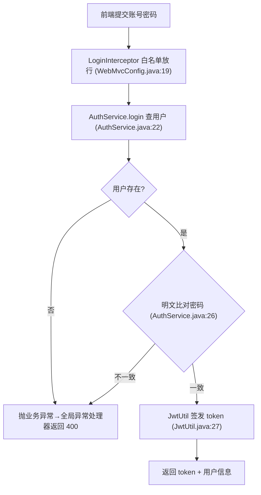
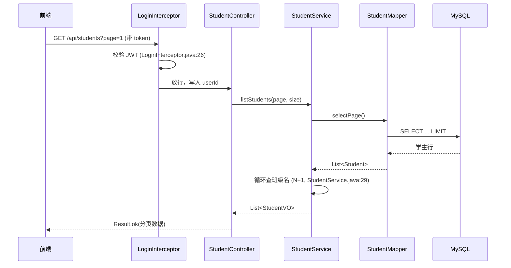
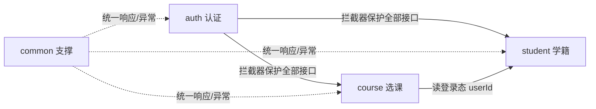

# Mermaid 流程图规范

产出"容易看"的图。本文是图类型选择、规模控制、语法避坑的硬规则。

## 1. 图类型选择

| 表达什么 | 用什么图 |
|---|---|
| 模块内一个功能的执行流程（含分支/失败分支） | `flowchart TD` |
| 一次请求跨层/跨模块的生命周期（浏览器→拦截器→controller→service→mapper→DB） | `sequenceDiagram` |
| 模块间调用/依赖关系 | `flowchart LR`（模块为节点，边标联系方式） |
| 订单/审核/选课等状态流转 | `stateDiagram-v2` |
| 表之间关系 | `erDiagram` |
| 系统分层 | `flowchart TB` + subgraph |

## 2. 规模控制（硬规则）

- **单张图 ≤ 15 个节点**（时序图 ≤ 7 个参与者 + ≤ 12 条消息）。超了必须拆成两张，用"图 3-1 / 图 3-2"编号，正文写明衔接关系（如"校验通过后进入 图 3-2 的落库阶段"）。
- 一张图只回答一个问题。"选课流程"一张图讲完正常+失败分支即可，别把"退课"也塞进来。
- flowchart 主流向自上而下 `TD`；模块关系图用 `LR`。
- 节点标签 ≤ 20 字，证据放标签尾部括号里。

## 3. 语法陷阱（高频翻车点）

1. **标签含特殊字符必须整体加引号**：括号、冒号、中文标点、引号都会炸图。
   - 正确：`A["校验密码 (AuthService.java:24)"]`
   - 错误：`A[校验密码 (AuthService.java:24)]`
2. **连线的标签**：`-->|"密码错误"|` 或 `-->|密码错误|`；标签里有引号/竖线时用 `--"文本"-->` 形式。
3. **时序图参与者必须用 as 别名**：`participant S as AuthService`；消息文本含特殊字符同样加引号不必要——`S->>M: 查用户(username)` 这类文本安全，但避免出现 `;` 和换行。
4. **stateDiagram 状态名不能带空格/特殊字符**：`state "已选课 ACTIVE" as active`，然后用 `active` 作状态 id。
5. **erDiagram 关系基数字符**：`||--o{`；属性写法 `string name "学号"`，注释里的中文没问题，但属性名用英文。
6. **注释必须独占一行且行首 `%%`**：`%% 图 3-1 登录流程`。
7. **节点 id 用英文**（`checkPwd`、`queryDb`），显示文本才用中文；id 不用数字开头、不含连字符开头。
8. **图的标题必须写在 mermaid 块内第一行注释**（`%% 图 3-1 登录流程`）——报告生成器会把这一行提取成图上方的可见标题条；写在代码块外面渲染后只会变成一行裸露的 `%%` 文本。正文引用图号（如"见图 4-3"），报告会自动把"图 N-M"转成可点击的交叉引用。

## 4. 推荐模板（直接套）

**功能流程图：**

**请求时序图：**

**模块关系图：**

## 5. 交付前自检

- [ ] 每张图上方有 `%% 图 N-M 标题` 注释，正文引用图号；
- [ ] 节点数 ≤ 15；标签全部加引号习惯统一；
- [ ] 关键节点带 `文件:行号` 证据；
- [ ] 图里的每条失败分支都有出口（返回什么错误），没有悬空箭头；
- [ ] 复杂流程拆图后，正文有衔接说明。
