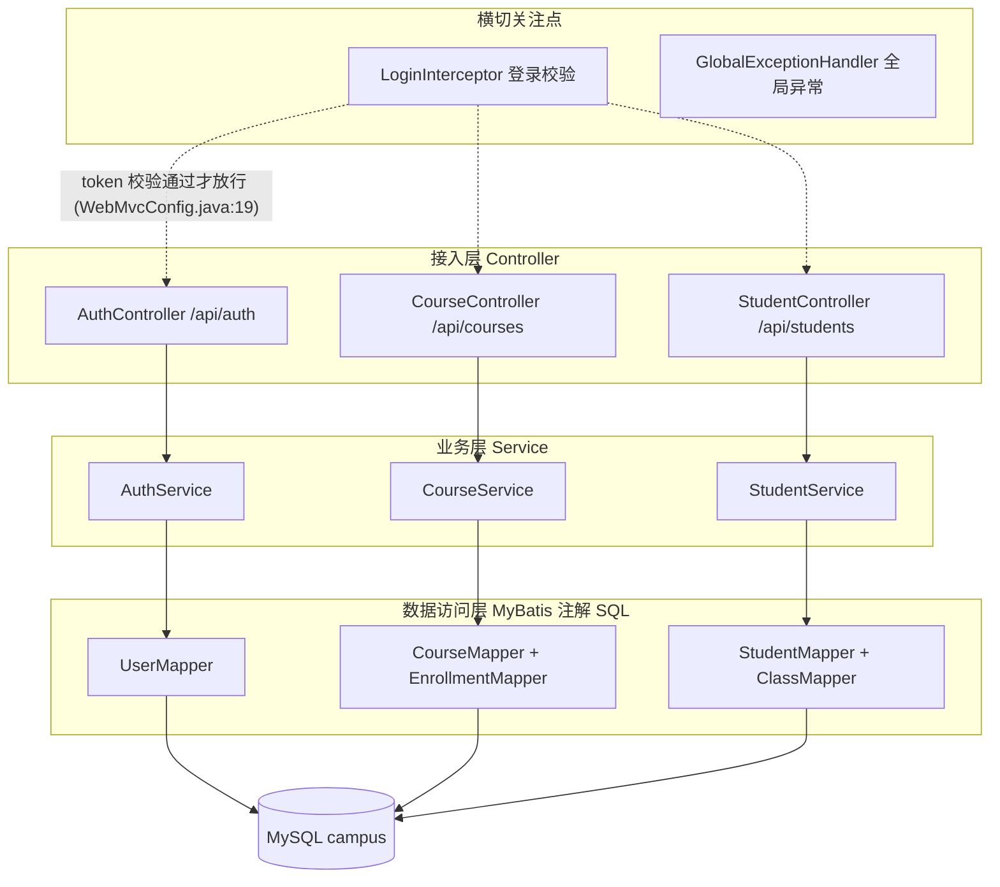
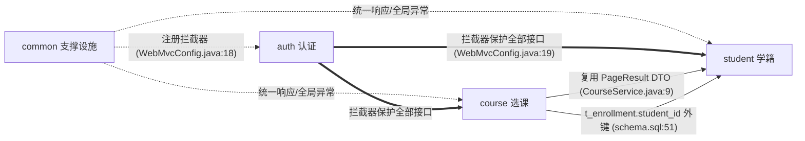
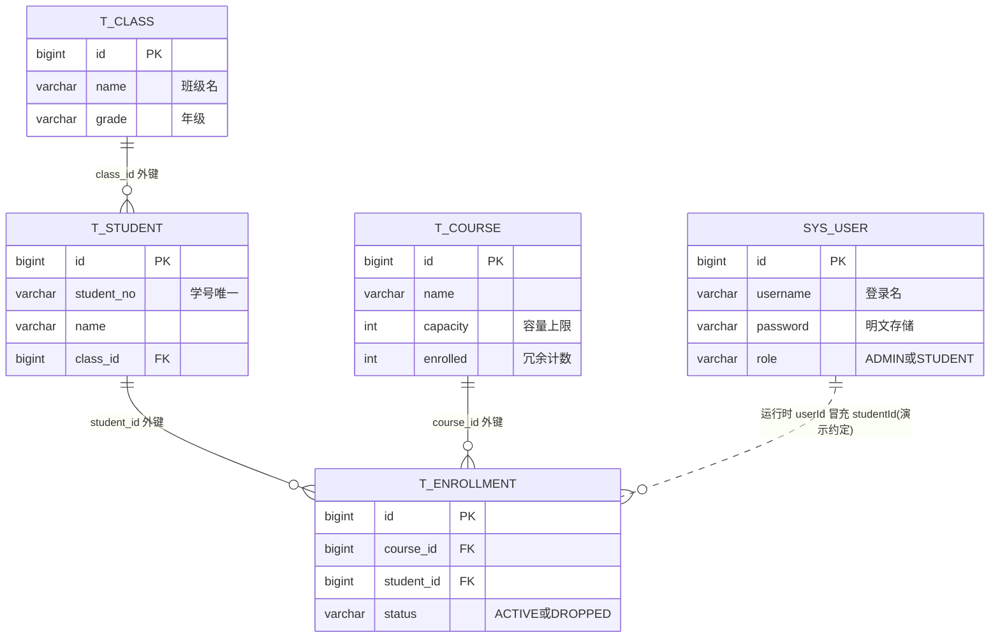
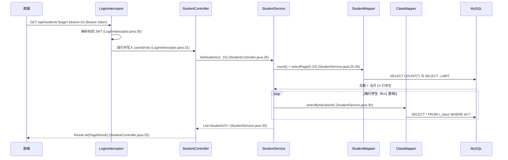

# 全局架构

## 1. 项目概览

demo-campus 是一个**校园管理系统单体后端**：认证、学籍、选课三个业务模块，面向管理员与学生两类角色（pom.xml:18 项目自述"校园管理系统：认证、学籍、选课三个业务模块"）。

| 项 | 值 | 证据 |
|---|---|---|
| 框架 | Spring Boot 3.2.5（父 POM） | pom.xml:10 |
| 语言 | Java 17 | pom.xml:21 |
| Web | spring-boot-starter-web（MVC，无模板引擎） | pom.xml:27 |
| 持久层 | MyBatis 3.0.3，**注解 SQL、无 XML** | pom.xml:30-33、application.yml:18 |
| 数据库 | MySQL，库名 campus，localhost:3306 | application.yml:11 |
| 认证 | jjwt 0.12.5，自实现拦截器（未用 Spring Security） | pom.xml:42、LoginInterceptor.java:16 |
| 端口 | 8080 | application.yml:2 |
| 部署形态 | 单体单进程，无 Dockerfile/k8s 清单，Mapper 扫描三包 | CampusApplication.java:8-10 |

没有定时任务、消息队列、WebSocket 与缓存中间件（全量 grep 无命中），是一个纯"HTTP → Service → MyBatis → MySQL"的教学型单体。

## 2. 系统分层

分层清晰：Controller 只做参数接收与 Result 包装（如 StudentController.java:23-26），业务全在 Service，SQL 全部以注解写在 Mapper 接口上。横切层中，拦截器在 Controller 之前生效（LoginInterceptor.java:22），异常处理器兜底所有 Controller 抛出的异常（GlobalExceptionHandler.java:9）。

## 3. 模块划分

| 模块 | 职责一句话 | 主要入口 | 拥有的表 | 详细文档 |
|---|---|---|---|---|
| auth 认证鉴权 | 登录签发 JWT + 拦截器统一校验注入登录态 | 2 个接口 | sys_user | modules/auth.md |
| student 学籍管理 | 学生增删改查与班级名填充 | 6 个接口 | t_student, t_class | modules/student.md |
| course 选课管理 | 课程浏览、选课退课、我的课表 | 6 个接口 | t_course, t_enrollment | modules/course.md |

**划分依据（布局 A：业务优先分包）**：三组包各自完整拥有 controller/service/mapper/entity/dto（`src/main/java/com/demo/campus/{auth,student,course}/`），且包名与 URL 前缀一致——`/api/auth`（AuthController.java:13）、`/api/students`（StudentController.java:15）、`/api/courses`（CourseController.java:17）。14 个入口点全部归属，无遗漏。

**支撑设施 common**：

| 类 | 提供什么 | 被谁用 |
|---|---|---|
| WebMvcConfig | 注册登录拦截器 + 白名单 | 全部请求（WebMvcConfig.java:17-24） |
| Result | 统一响应 `{code, message, data}` | 全部 Controller（Result.java:15） |
| GlobalExceptionHandler | BusinessException→400、其他→500 | 全部 Controller（GlobalExceptionHandler.java:12-21） |
| BusinessException | 携带 code 的业务异常 | auth/course/student 三模块（如 AuthService.java:23） |

## 4. 模块关系

逐条解释（对应 playbook 的三类联系证据）：

1. **common → auth（代码调用）**：WebMvcConfig import 并注册 LoginInterceptor（WebMvcConfig.java:3,18），这是支撑设施对 auth 的直接依赖。
2. **auth → student / auth → course（运行时约定）**：粗线。拦截器保护 `/**` 除白名单外的全部接口（WebMvcConfig.java:19-23），并把 userId/role 写入 request 属性（LoginInterceptor.java:31-32）；course 读取 userId 当 studentId 用（CourseController.java:64），auth 的 `/api/auth/me` 也读它（AuthController.java:28）。
3. **course → student（代码调用）**：CourseService import 了 student 包下的 PageResult（CourseService.java:9）。这是**结构问题**：分页 DTO 是通用构件，放在某个业务包里被别的模块引用，应下沉到 common（详见 modules/course.md 设计评价）。
4. **course → student（数据耦合）**：t_enrollment.student_id 外键声明指向 t_student.id（schema.sql:51）。但运行时写入的其实是 sys_user.id（演示约定，见 O3-4），两套 ID 语义混用是本项目最大的数据隐患。

## 5. 数据模型

每张表一句话：

- **sys_user**（schema.sql:5-12）：登录账号，密码明文（O1-1），role 字段无人消费（O1-4）。
- **t_class**（schema.sql:14-19）：班级字典表，只有读接口，无维护入口。
- **t_student**（schema.sql:21-30）：学籍主表，学号唯一（:23），被选课表外键引用（:51）。
- **t_course**（schema.sql:32-41）：课程表，enrolled 是随选退课 ±1 的冗余计数（:39），一致性全靠应用代码维护（O3-1/O3-2）。
- **t_enrollment**（schema.sql:43-52）：选课记录，(course_id, student_id) 唯一（:49），用 status 翻转表达退课、保留历史。

## 6. 一个请求的完整旅程（示例）

以最典型的 `GET /api/students`（分页查学生，含 N+1 缺陷）为例，走完整链路：

看点：① 请求先过拦截器，token 无效直接 401，Controller 根本不会执行；② 若中途抛 BusinessException，GlobalExceptionHandler.java:13 兜底转 `Result.error`；③ 第 8-10 步的循环查库就是 O2-1 指出的 N+1。

## 7. 优化建议汇总

| 编号 | 模块 | 问题 | 严重程度 | 详情 |
|---|---|---|---|---|
| O1-1 | auth | 密码明文存储与明文比对 | 高 | modules/auth.md#o1-1 |
| O1-2 | auth | JWT 签名密钥硬编码在源码 | 高 | modules/auth.md#o1-2 |
| O1-3 | auth | 登录无失败次数限制、无验证码 | 中 | modules/auth.md#o1-3 |
| O1-4 | auth | role 写入登录态后无消费方，缺角色级鉴权 | 高 | modules/auth.md#o1-4 |
| O2-1 | student | 列表与搜索的 N+1 查询 | 中 | modules/student.md#o2-1 |
| O2-2 | student | 学号查重 check-then-act，并发下报 500 | 中 | modules/student.md#o2-2 |
| O2-3 | student | 更新/删除不校验存在性与影响行数，删除撞外键 | 中 | modules/student.md#o2-3 |
| O2-4 | student | 姓名搜索双 % LIKE 且无分页 | 低 | modules/student.md#o2-4 |
| O2-5 | student | 分页 size 参数无上限 | 低 | modules/student.md#o2-5 |
| O3-1 | course | 选课多步写无事务 + 容量并发超卖 | 高 | modules/course.md#o3-1 |
| O3-2 | course | 退课不校验有效记录，重复退课人数减成负数 | 高 | modules/course.md#o3-2 |
| O3-3 | course | 我的课表 N+1 查询 | 中 | modules/course.md#o3-3 |
| O3-4 | course | 运行时把 sys_user.id 当 t_student.id 用 | 高 | modules/course.md#o3-4 |
| O3-5 | course | 并发重复选课命中唯一键后返回 500 | 低 | modules/course.md#o3-5 |

共 14 条：高 6 条（全部集中在安全与数据一致性），中 5 条，低 3 条。每条的五段式详情见对应模块文档"优化建议"小节。
