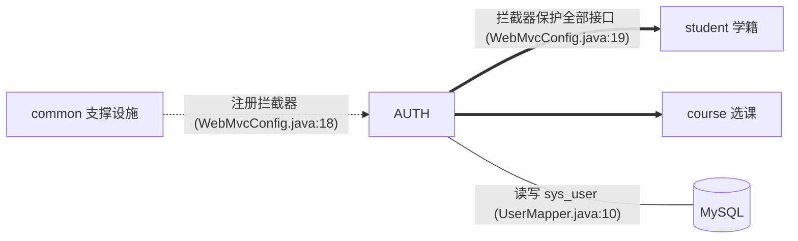
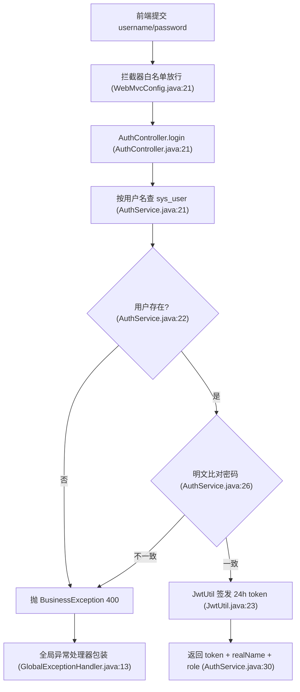
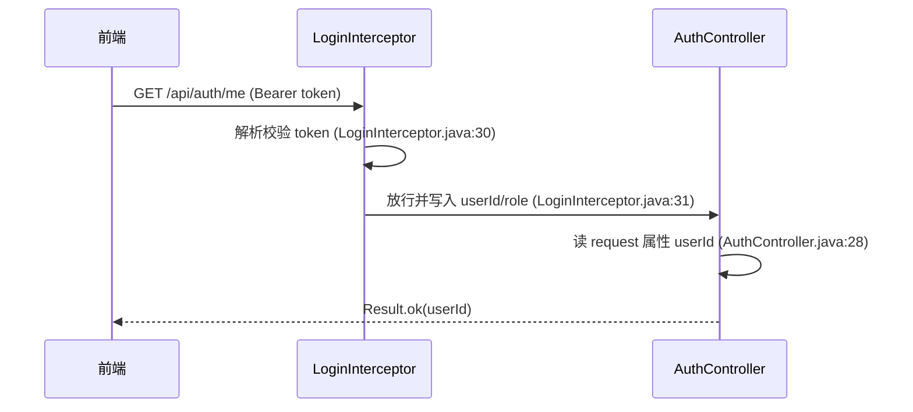
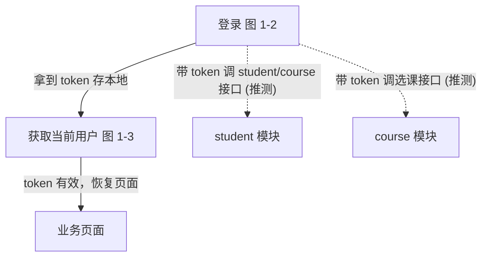

# 模块：认证鉴权（auth）

> 登录签发 JWT、拦截器统一校验 token 并注入登录态。它是全系统的"门卫"：student、course 两个模块的全部接口都依赖它写入的 userId/role 属性。

## 1. 职责与边界

**本模块在全局中的位置**（一眼看清它和谁有关系，详细关系见 00-architecture.md §4）：

- **管什么**：账号密码登录、JWT 签发与校验（`AuthService.java:20`、`JwtUtil.java:23`）、登录态注入（`LoginInterceptor.java:31`）。
- **不管什么**：角色权限判断（role 属性写入后全项目无消费方，见 O1-4）、用户管理 CRUD（sys_user 无增删改接口）。
- **被谁依赖**：common 配置类注册本模块拦截器（`WebMvcConfig.java:3`）；course 控制器读取本模块写入的 userId（`CourseController.java:64`）。

## 2. 功能清单

| 功能 | HTTP | 路径 | 入口方法 | 数据表 | 流程 |
|---|---|---|---|---|---|
| 登录 | POST | /api/auth/login | AuthController.login | sys_user | [图 1-2](#图 1-2) |
| 获取当前用户 | GET | /api/auth/me | AuthController.me | 无（读 request 属性） | [图 1-3](#图 1-3) |

## 3. 功能详解

### 3.1 登录

**设计意图**：无状态认证——登录成功后签发 24 小时 JWT，后续请求只靠 token 自证身份，服务端不存会话。

| 步骤 | 做什么 | 代码位置 |
|---|---|---|
| 1 | 白名单放行（唯一免登录接口） | WebMvcConfig.java:21 |
| 2 | 按用户名查用户，`SELECT * FROM sys_user WHERE username=#{username}` | UserMapper.java:10 |
| 3 | 用户不存在 → 抛"用户名或密码错误" | AuthService.java:22-24 |
| 4 | 密码**明文 equals 比对**，不一致 → 同样报错 | AuthService.java:26-28 |
| 5 | 以 userId 为 subject、role 为 claim 签发 token，有效期 24h | JwtUtil.java:23-32 |
| 6 | 返回 `LoginResponse(token, realName, role)` | AuthService.java:30 |

**流程跳转**：登录成功后前端拿 token 调任意业务接口（推测：无前端代码佐证）；登录失败统一由全局异常处理器返回 `Result.error(400, "用户名或密码错误")`（GlobalExceptionHandler.java:13）。

**设计评价**：用户不存在与密码错误返回同一句话，避免用户名枚举，这点是对的；但密码明文比对（O1-1）和密钥硬编码（O1-2）是必须改的安全债。

### 3.2 获取当前用户

**设计意图**：给前端一个"校验 token 是否仍有效、我是谁"的轻量探针，不查库，直接读拦截器写入的登录态。

| 步骤 | 做什么 | 代码位置 |
|---|---|---|
| 1 | 拦截器取 Authorization 头，无 Bearer 前缀 → 401"未登录" | LoginInterceptor.java:24-28 |
| 2 | 解析 token，失败 → 401"登录已过期"（直接写响应，不走全局异常处理器） | LoginInterceptor.java:34-37 |
| 3 | 把 subject（userId）与 role 写入 request 属性后放行 | LoginInterceptor.java:31-32 |
| 4 | 控制器读回 userId 返回 | AuthController.java:28-29 |

**流程跳转**：本功能通常在页面刷新时调用以恢复登录态（推测）；token 无效时前端应跳回登录页重走 图 1-2（推测）。

**设计评价**：这是"运行时约定"的典型——拦截器写属性、控制器读属性，`AuthController.java:25` 的注释把它讲明了；但也埋下 O1-4（role 写了没人用）的伏笔。

## 4. 功能跳转地图

最典型路径：未登录用户先走 图 1-2 拿 token，之后所有请求自动携带 token 经拦截器校验；前端用 图 1-3 探测登录态是否过期。

## 5. 涉及的数据表

**sys_user**（sql/schema.sql:5-12）：系统用户表。

| 字段 | 类型 | 说明 |
|---|---|---|
| id | BIGINT PK | 用户 ID，JWT subject 用的就是它（JwtUtil.java:26） |
| username | VARCHAR(50) UNIQUE | 登录名（schema.sql:7） |
| password | VARCHAR(100) | **明文存储**（schema.sql:8、User.java:13） |
| role | VARCHAR(20) | ADMIN / STUDENT（schema.sql:10） |

与其它模块的关联：本表没有外键指向 student 模块的 t_student；运行时 userId 被 course 模块直接当作 studentId 使用，属于语义混用（见 modules/course.md O3-4）。

## 6. 优化建议

### O1-1 密码明文存储与明文比对（严重程度：高）

- **现状证据**：`AuthService.java:26` `if (!user.getPassword().equals(request.getPassword()))`；`User.java:13` 注释"数据库中明文存储"；`sql/schema.sql:8` `COMMENT '明文存储'`。
- **问题**：口令未做单向散列，登录时明文 equals 比对。
- **影响**：数据库一旦泄露全部口令即刻可用；内部运维/日志/备份任何环节都能看到用户原始密码。
- **建议方案**：注册侧改 `new BCryptPasswordEncoder().encode(rawPwd)`，登录侧改 `passwordEncoder.matches(rawPwd, user.getPassword())`（引入 `spring-security-crypto` 单个依赖即可，不必整套装 Spring Security）；存量数据加 `deprecated` 标记、用户下次登录成功时透明升级重哈希。
- **预期收益**：拖库后攻击者无法直接得到可用口令；比对面从 O(明文) 变为标准哈希校验，安全基线达标。

### O1-2 JWT 签名密钥硬编码在源码（严重程度：高）

- **现状证据**：`JwtUtil.java:17` `private static final String SECRET = "campus-jwt-secret-key-0123456789abcdef";`
- **问题**：签名密钥随代码进仓库，任何能读源码的人都能伪造任意用户/角色的合法 token。
- **影响**：伪造 `role=ADMIN` 的 token 即可通过全部接口的登录校验（拦截器只验签名不验角色，LoginInterceptor.java:30-33），等于认证体系被整体绕过。
- **建议方案**：密钥移到环境变量/配置中心，`@ConfigurationProperties` 注入 JwtUtil；同时密钥长度与轮换策略写入配置说明。
- **预期收益**：源码泄露不再等于认证体系失守；换环境（测试/生产）可使用不同密钥。

### O1-3 登录接口无失败次数限制、无验证码（严重程度：中）

- **现状证据**：`AuthService.java:20-31` 整个登录方法没有任何失败计数/锁定逻辑；`WebMvcConfig.java:21` 登录接口在白名单中，可无限次匿名调用。
- **问题**：可对 `/api/auth/login` 无限暴力试密码。
- **影响**：弱口令账号可被脚本撞库攻破，配合 O1-1 明文存储后果加倍。
- **建议方案**：以"用户名+IP"为键做失败计数（如 Redis `INCR` + 5 次/15 分钟锁定），超限返回 429；或接入验证码。
- **预期收益**：暴力破解成本从"零门槛"提升到"每 IP 每刻度 5 次"，撞库基本失效。

### O1-4 role 写入登录态后全项目无消费方，缺角色级鉴权（严重程度：高）

- **现状证据**：`JwtUtil.java:27` 把 role 写进 claim；`LoginInterceptor.java:32` 写入 request 属性；但全项目没有任何代码读取该属性做权限判断（`AuthController.java` 只用 userId；student/course 的写接口也未校验角色）。
- **问题**：鉴权只做了"认证"（你是不是登录了），没做"授权"（你能不能干这事）。
- **影响**：任何登录用户（含 STUDENT）可新增课程（CourseController.java:57）、增删改任意学生（StudentController.java:39-55），数据可被普通用户随意破坏。
- **建议方案**：新增 `@RequireRole("ADMIN")` 注解 + 拦截器/AOP 读取 role 属性校验，套在全部写接口上；或引入 Spring Security 的方法级 `@PreAuthorize`。
- **预期收益**：管理类接口只允许 ADMIN 触达，普通学生无法篡改学籍与课程数据。
