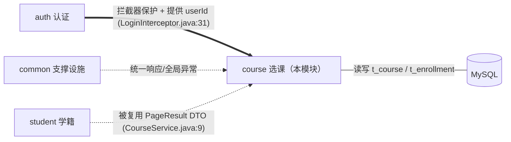
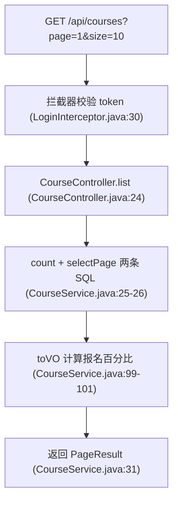
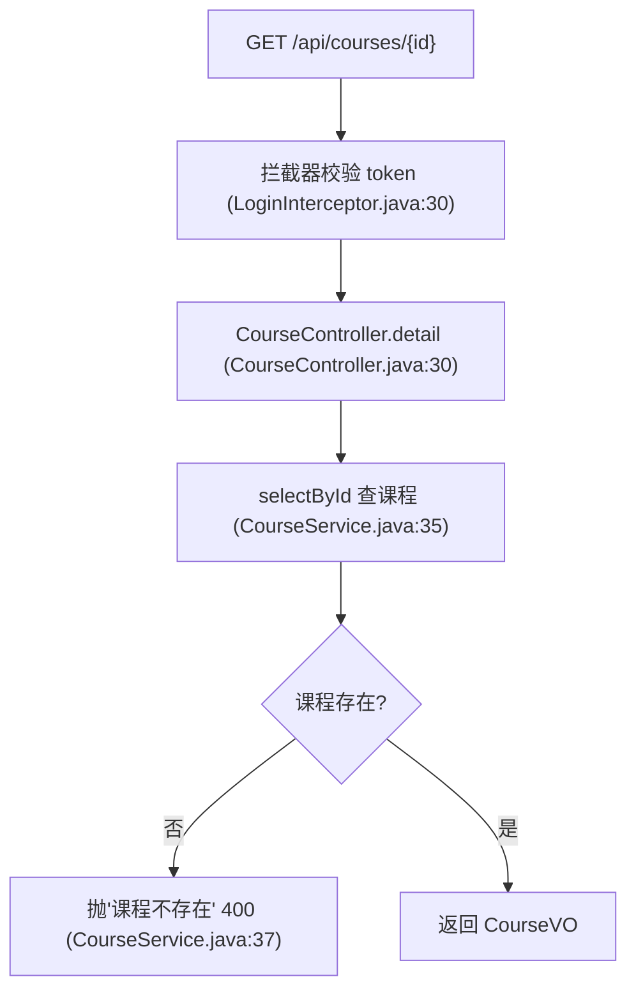
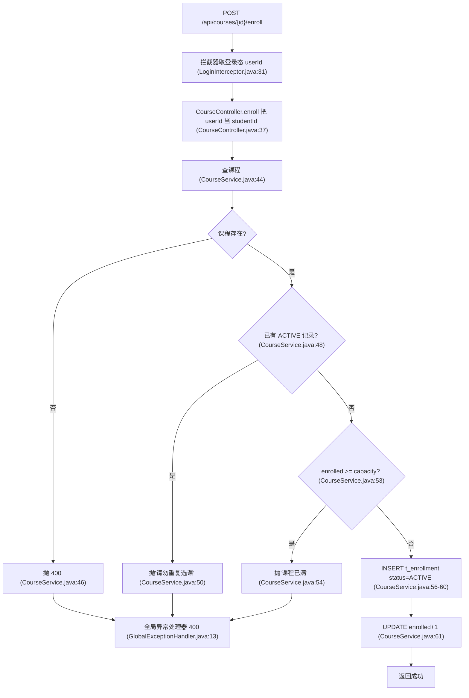
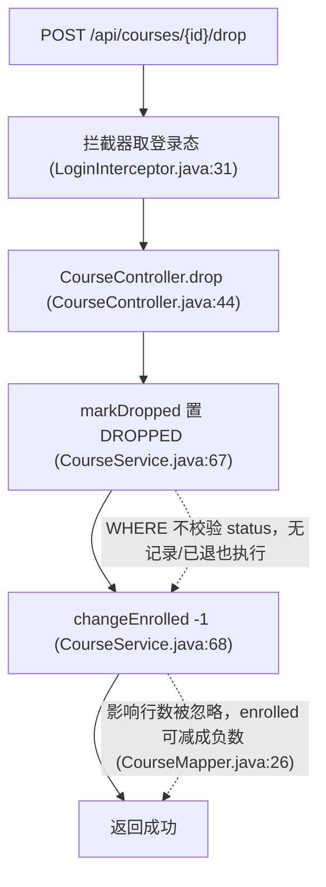
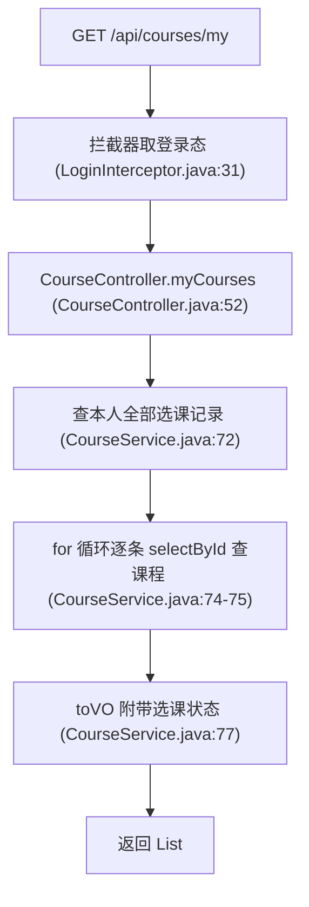
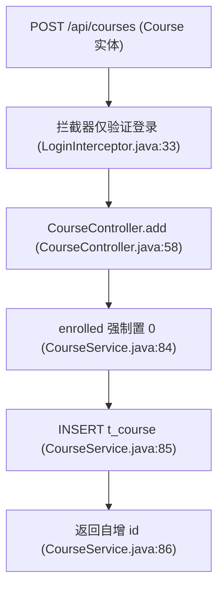
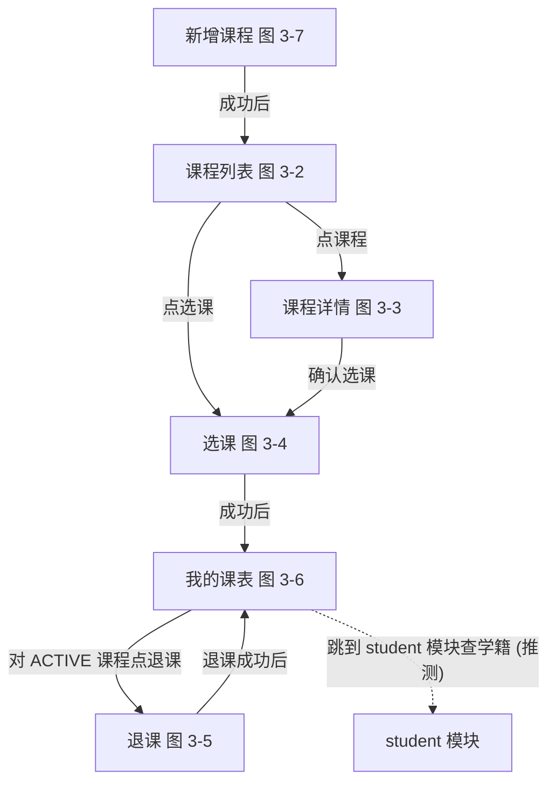

# 模块：选课管理（course）

> 课程浏览、选课、退课、我的课表。这是全系统业务含量最高的模块：容量控制 + 冗余计数 + 状态流转（ACTIVE/DROPPED），也因此集中了并发、事务、幂等三类经典问题。

## 1. 职责与边界

**本模块在全局中的位置**（详细关系见 00-architecture.md §4）：

- **管什么**：t_course 的浏览与新增、t_enrollment 的选课/退课/查询、t_course.enrolled 冗余计数的维护（`CourseMapper.java:26`）。
- **不管什么**：学生与用户信息（直接拿登录态 userId 当 studentId 用，见 O3-4）；班级、成绩等业务。
- **依赖谁**：student 模块的 `PageResult` DTO（CourseService.java:9，跨模块复用错位）；auth 模块的登录态属性（CourseController.java:64）。
- **被谁依赖**：无——本模块是业务的"下游终点"。

## 2. 功能清单

| 功能 | HTTP | 路径 | 入口方法 | 数据表 | 流程 |
|---|---|---|---|---|---|
| 课程列表 | GET | /api/courses | CourseController.list | t_course | [图 3-2](#图 3-2) |
| 课程详情 | GET | /api/courses/{id} | CourseController.detail | t_course | [图 3-3](#图 3-3) |
| 选课 | POST | /api/courses/{id}/enroll | CourseController.enroll | t_course, t_enrollment | [图 3-4](#图 3-4) |
| 退课 | POST | /api/courses/{id}/drop | CourseController.drop | t_course, t_enrollment | [图 3-5](#图 3-5) |
| 我的课表 | GET | /api/courses/my | CourseController.myCourses | t_enrollment, t_course | [图 3-6](#图 3-6) |
| 新增课程 | POST | /api/courses | CourseController.add | t_course | [图 3-7](#图 3-7) |

## 3. 功能详解

### 3.1 课程列表

**设计意图**：选课第一屏，展示课程与报名进度（enrolledPercent 百分比由服务端算好）。

| 步骤 | 做什么 | 代码位置 |
|---|---|---|
| 1 | `SELECT COUNT(*) FROM t_course` | CourseMapper.java:11 |
| 2 | `SELECT * ... LIMIT #{offset}, #{size}` | CourseMapper.java:14 |
| 3 | toVO 补 `enrolledPercent = enrolled*100/capacity` | CourseService.java:99-101 |

**流程跳转**：列表点课程进详情 图 3-3，点"选课"直接走 图 3-4（推测）。

**设计评价**：课程列表不查选课关系，无 N+1；size 无上限问题同 student（见 modules/student.md O2-5）。

### 3.2 课程详情

**设计意图**：查看单门课程完整信息，作为选课前的确认页。

| 步骤 | 做什么 | 代码位置 |
|---|---|---|
| 1 | 按 id 查课程，不存在抛 BusinessException | CourseService.java:35-38 |

**流程跳转**：详情页"确认选课"→ 图 3-4（推测）。

**设计评价**：与 3.1 共用 toVO，失败分支显式判空，写法干净。

### 3.3 选课

**设计意图**：核心事务型操作——查课程、防重复、控容量、写选课记录、维护冗余计数，五步一气呵成。

| 步骤 | 做什么 | 代码位置 |
|---|---|---|
| 1 | userId 取自拦截器写入的属性（**是 sys_user.id，非 t_student.id**） | CourseController.java:37、62-66 |
| 2 | 查课程，不存在抛 400 | CourseService.java:44-47 |
| 3 | 查 `status='ACTIVE'` 的既有记录防重复 | EnrollmentMapper.java:11-13 |
| 4 | 容量判断（注释自认"三步之间没有事务保护"） | CourseService.java:52-55 |
| 5 | 插入 ACTIVE 选课记录 | CourseService.java:56-60 |
| 6 | 冗余计数 +1：`enrolled = enrolled + #{delta}` | CourseMapper.java:26-27 |

**流程跳转**：选课成功后前端通常跳"我的课表" 图 3-6 验证结果（推测）；三个失败分支均返回 400。

**设计评价**：防重复、控容量的意图都对，但五步写操作无 `@Transactional`（O3-1）：第 5 步成功第 6 步失败会出现"有记录但人数没加"的脏数据；容量判断是 check-then-act，并发下可超卖。

### 3.4 退课

**设计意图**：把选课记录从 ACTIVE 置为 DROPPED 并释放名额，保留历史记录（不物理删除）。

| 步骤 | 做什么 | 代码位置 |
|---|---|---|
| 1 | `UPDATE t_enrollment SET status='DROPPED' WHERE course_id=? AND student_id=?`（**不限定当前 status，返回行数被忽略**） | EnrollmentMapper.java:23-25、CourseService.java:67 |
| 2 | 冗余计数 -1（同样不看返回值） | CourseService.java:68 |

**流程跳转**：退课成功后回"我的课表" 图 3-6，记录显示 DROPPED（推测）。

**设计评价**：注释承认"未校验是否存在有效的选课记录"（CourseService.java:66）。对一个从未选课/已退课的课程反复调 drop，人数会一直减（O3-2），两次写之间也无事务。

### 3.5 我的课表

**设计意图**：学生的个人选课结果页，按选课记录倒序展示每门课的状态。

| 步骤 | 做什么 | 代码位置 |
|---|---|---|
| 1 | `SELECT * FROM t_enrollment WHERE student_id=? ORDER BY id DESC` | EnrollmentMapper.java:15-16 |
| 2 | **循环内逐条**查课程——N+1 查询 | CourseService.java:74-78 |

**流程跳转**：课表里可对 ACTIVE 课程发起退课 图 3-5（推测）。

**设计评价**：与 student 模块同款 N+1（O3-3）；`ORDER BY id DESC` 让最新选课排最前，细节合理。

### 3.6 新增课程

**设计意图**：管理端创建课程，enrolled 从 0 起步。

| 步骤 | 做什么 | 代码位置 |
|---|---|---|
| 1 | 服务端强制 `enrolled=0`，防调用方传值 | CourseService.java:84 |
| 2 | INSERT + useGeneratedKeys 返回 id | CourseMapper.java:20-23 |

**流程跳转**：新增成功后回课程列表 图 3-2（推测）。

**设计评价**：功能本身简单，但**任何登录用户（含学生）都能建课**——role 校验缺失，归属 O1-4 一并看；另外 `CourseController.java:8` import 了 LoginInterceptor 却从未使用，属残留代码。

## 4. 功能跳转地图

最典型路径：学生从课程列表 图 3-2 → 详情 图 3-3 → 选课 图 3-4 → 课表 图 3-6 核对 → 不合适再退课 图 3-5；管理员路径是新增 图 3-7 → 列表。

## 5. 涉及的数据表

**t_course**（sql/schema.sql:32-41）：课程表。

| 字段 | 类型 | 说明 |
|---|---|---|
| capacity | INT | 容量上限（schema.sql:38） |
| enrolled | INT | **冗余计数**，随选课/退课 ±1（schema.sql:39、Course.java:17-18） |

**t_enrollment**（sql/schema.sql:43-52）：选课记录表。

| 字段 | 类型 | 说明 |
|---|---|---|
| status | VARCHAR(20) | ACTIVE 在读 / DROPPED 已退（schema.sql:47、Enrollment.java:14-15） |
| uk_course_student | UNIQUE | (course_id, student_id) 唯一（schema.sql:49）——同一条选课关系只留一行，靠 status 翻转表达退课 |

与其它模块的关联：`t_enrollment.course_id` → t_course.id（schema.sql:50）；`t_enrollment.student_id` 外键声明指向 student 模块的 t_student.id（schema.sql:51），但运行时写入的是 auth 模块 sys_user 的 userId（见 O3-4）。

## 6. 优化建议

### O3-1 选课多步写无事务 + 容量 check-then-act 并发超卖（严重程度：高）

- **现状证据**：`CourseService.java:52` 注释自认"先判断容量，再插入记录、再更新人数：三步之间没有事务保护"；enroll 方法无 `@Transactional`；容量判断 `CourseService.java:53` 为普通读取比较。
- **问题**：(1) INSERT（:60）与 UPDATE（:61）不在同一事务，第二步失败留下"有 ACTIVE 记录但 enrolled 没加"的不一致；(2) 并发选最后 1 个名额时，多个请求同时通过 ：53 的检查，各自插入并 +1，最终 enrolled 超过 capacity。
- **影响**：开学抢课场景必然触发；超卖导致课堂容量失控，脏数据需要人工对账。
- **建议方案**：方法加 `@Transactional`；容量扣减改为原子条件更新 `UPDATE t_course SET enrolled = enrolled + 1 WHERE id=? AND enrolled < capacity`，以返回行数=0 判"课程已满"，替代先查后写；配合 t_enrollment 的 UNIQUE（schema.sql:49）兜底防重。
- **预期收益**：任何并发下 enrolled ≤ capacity 恒成立，两步写要么全成要么全不做，选课结果与计数强一致。

### O3-2 退课不校验有效记录、不检查影响行数，重复退课把人数减成负数（严重程度：高）

- **现状证据**：`EnrollmentMapper.java:23-25` UPDATE 的 WHERE 只有 course_id+student_id，**不含 status='ACTIVE'**；`CourseService.java:66` 注释自认"未校验是否存在有效的选课记录"；`CourseService.java:67-68` 返回值被丢弃。
- **问题**：对未选课/已退课的课程反复调 drop，每次都执行 `enrolled - 1`。
- **影响**：enrolled 变成负数且持续走低，容量判断 `enrolled >= capacity`（:53）随之失真，别人永远能"选上"，数据彻底不可信。
- **建议方案**：UPDATE 加条件 `AND status='ACTIVE'`，检查返回行数，`rows==0` 抛 `BusinessException("未选中该课程")`；与 O3-1 一样放入事务。
- **预期收益**：退课天然幂等，重复点击不产生副作用；enrolled 与 ACTIVE 记录数恒一致。

### O3-3 我的课表 N+1 查询（严重程度：中）

- **现状证据**：`CourseService.java:74-78` 循环内逐条 `courseMapper.selectById(e.getCourseId())`。
- **问题**：N 条选课记录触发 N 次课程查询。
- **影响**：一学期选 10 门课就是 11 条 SQL；课表是高频访问页，DB 往返被白白放大。
- **建议方案**：一条 JOIN 搞定：`SELECT e.*, c.name, c.teacher, ... FROM t_enrollment e JOIN t_course c ON e.course_id = c.id WHERE e.student_id = #{studentId} ORDER BY e.id DESC`，直接映射 CourseVO。
- **预期收益**：SQL 次数从 1+N 降为 1，课表接口延迟稳定。

### O3-4 运行时把 sys_user.id 当 t_student.id 用，两套 ID 语义混用（严重程度：高）

- **现状证据**：`CourseController.java:62-66` 注释自认"演示用：从拦截器写入的属性里取当前用户，作为 studentId"，把 `userId`（JWT subject，即 sys_user.id，JwtUtil.java:26）直接传入 enroll/drop/myCourses；而 `sql/schema.sql:51` 声明 `t_enrollment.student_id` 外键指向 t_student.id。
- **问题**：sys_user 与 t_student 是两张独立表、两套自增 ID，没有任何绑定关系。
- **影响**：仅当两表恰好 id 相同时数据才"看起来对"；不同步时 A 用户的选课记录挂在 B 学生名下，退课/课表全部错乱，且外键约束可能因 student_id 在 t_student 不存在而直接报错。
- **建议方案**：t_student 增加 user_id 列建立正式绑定，enroll 前按登录 userId 查出真实 studentId；或让 t_enrollment.student_id 直接存 sys_user.id 并改外键指向 sys_user，全链路统一口径。
- **预期收益**：选课记录归属确定，消除"看别人的课表"级的数据错乱。

### O3-5 并发重复选课命中唯一键后返回 500（严重程度：低）

- **现状证据**：`CourseService.java:60` INSERT 依赖 `uk_course_student`（sql/schema.sql:49）兜底，但未捕获 DuplicateKeyException，会落到 `GlobalExceptionHandler.java:17-21` 返回 500"系统繁忙"。
- **问题**：并发双击选课时第二个请求语义上是"重复选课"（应为 400），实际报 500。
- **影响**：用户以为系统故障；监控里出现无意义的 500 噪音。
- **建议方案**：enroll 捕获 `DuplicateKeyException` 转 `BusinessException("请勿重复选课")`，与 ：50 的前置检查形成"友好提示 + 数据库兜底"双保险。
- **预期收益**：并发场景下响应码与语义一致，错误监控噪音消除。
