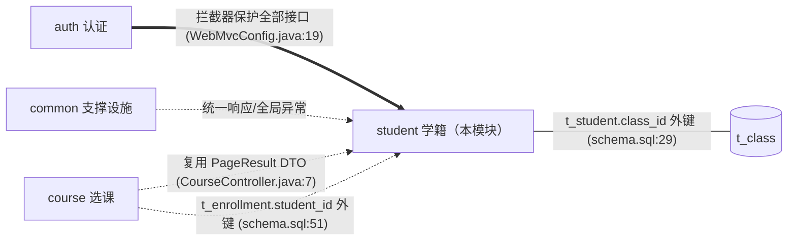
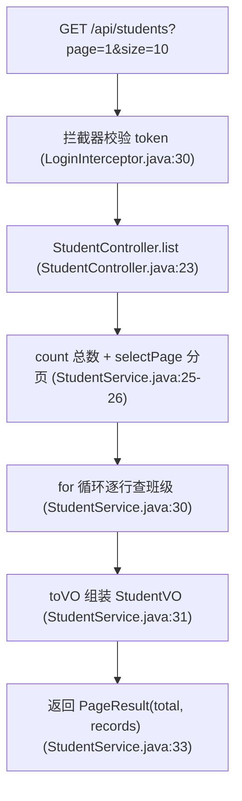
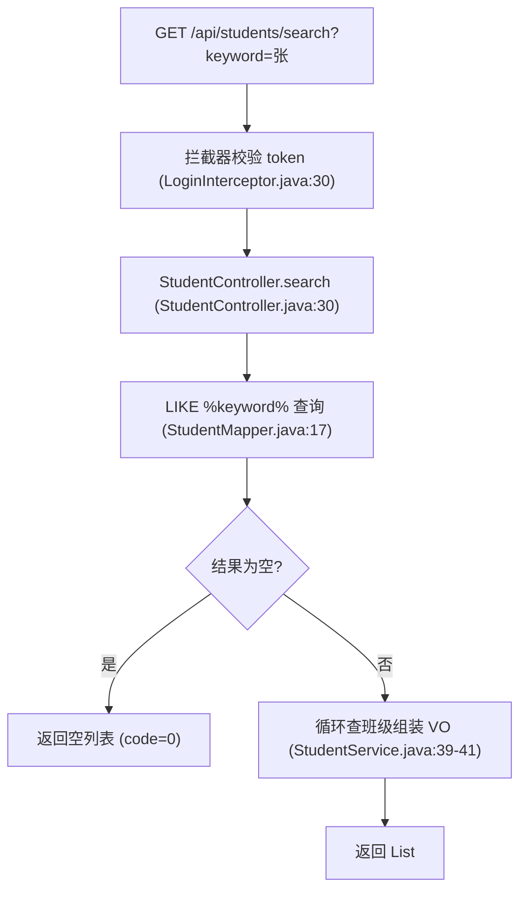
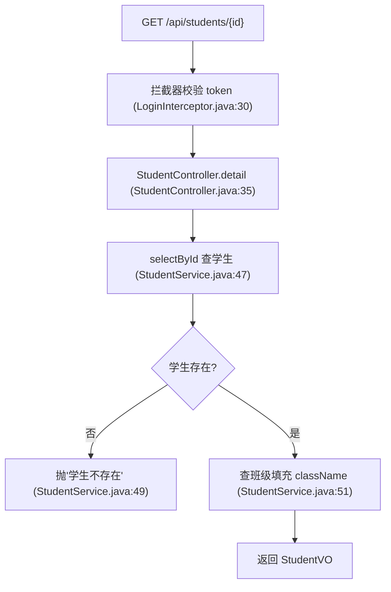
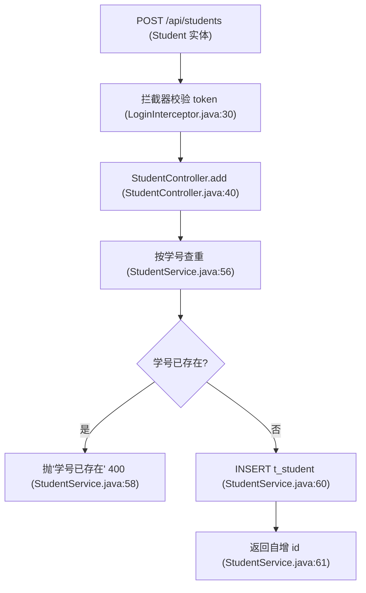
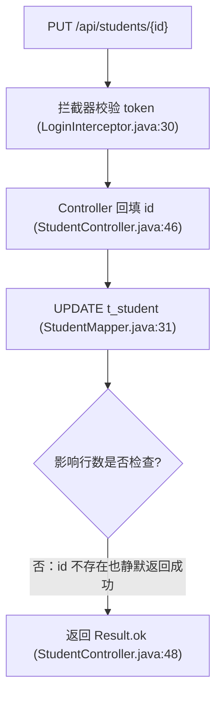
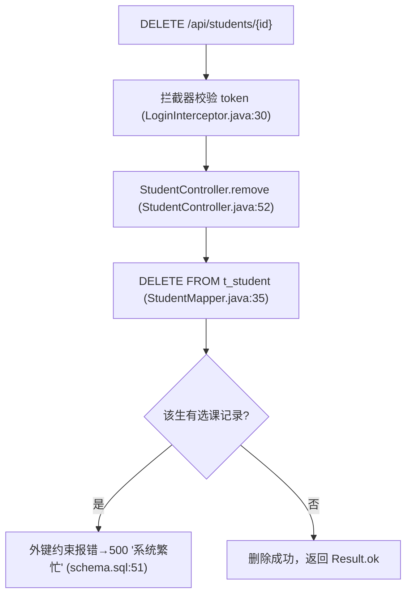
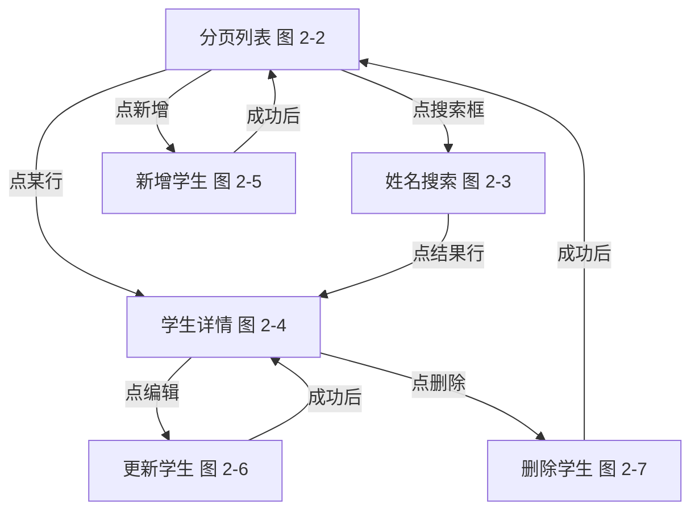

# 模块：学籍管理（student）

> 学生的增删改查与班级信息填充。它是系统里最典型的单表 CRUD 模块，但已经埋了 N+1 查询、静默失败、并发查重三类常见问题，正好当"反面教材"细读。

## 1. 职责与边界

**本模块在全局中的位置**（详细关系见 00-architecture.md §4）：

- **管什么**：t_student 的增删改查、t_class 班级名联查（`StudentService.java:72-81`）、学号唯一性校验（`StudentService.java:56`）。
- **不管什么**：班级的维护（t_class 无任何写接口，ClassMapper 只有 selectById）；选课业务（属于 course 模块，但删除学生会撞它的外键，见 O2-3）。
- **被谁依赖**：course 模块 import 了本模块的 `PageResult`（CourseService.java:9）——这是一个跨模块 DTO 错位，见 00-architecture.md §4。

## 2. 功能清单

| 功能 | HTTP | 路径 | 入口方法 | 数据表 | 流程 |
|---|---|---|---|---|---|
| 分页列表 | GET | /api/students | StudentController.list | t_student, t_class | [图 2-2](#图 2-2) |
| 姓名搜索 | GET | /api/students/search | StudentController.search | t_student, t_class | [图 2-3](#图 2-3) |
| 学生详情 | GET | /api/students/{id} | StudentController.detail | t_student, t_class | [图 2-4](#图 2-4) |
| 新增学生 | POST | /api/students | StudentController.add | t_student | [图 2-5](#图 2-5) |
| 更新学生 | PUT | /api/students/{id} | StudentController.update | t_student | [图 2-6](#图 2-6) |
| 删除学生 | DELETE | /api/students/{id} | StudentController.remove | t_student | [图 2-7](#图 2-7) |

## 3. 功能详解

### 3.1 分页列表

**设计意图**：管理端首页的学生名单，LIMIT 分页 + 每行补班级名。

| 步骤 | 做什么 | 代码位置 |
|---|---|---|
| 1 | `SELECT COUNT(*) FROM t_student` 取总数 | StudentMapper.java:11 |
| 2 | `SELECT * ... LIMIT #{offset}, #{size}` 取当页 | StudentMapper.java:14 |
| 3 | **循环内逐行** `classMapper.selectById(classId)`——N+1 查询（代码注释自认） | StudentService.java:29-30 |
| 4 | 实体转 VO（补 className） | StudentService.java:72-81 |

**流程跳转**：前端通常从列表点某行进详情 图 2-4，或点"新增"走 图 2-5（推测）。

**设计评价**：分页本身写法标准；但 N+1（O2-1）在数据量上来后是第一个性能炸点。

### 3.2 姓名搜索

**设计意图**：按姓名关键字模糊找人，给前端搜索框用。

| 步骤 | 做什么 | 代码位置 |
|---|---|---|
| 1 | `WHERE name LIKE CONCAT('%', #{keyword}, '%')` | StudentMapper.java:17 |
| 2 | 同样循环查班级（第二次 N+1） | StudentService.java:39-41 |

**流程跳转**：搜索结果点行进详情 图 2-4（推测）。

**设计评价**：参数用 `#{}` 预编译，无注入风险；但双 `%` 前缀 LIKE 走不了索引且无分页（O2-4）。

### 3.3 学生详情

**设计意图**：查看单个学生，含班级名。

| 步骤 | 做什么 | 代码位置 |
|---|---|---|
| 1 | 按 id 查学生，不存在抛 BusinessException | StudentService.java:47-50 |
| 2 | 按班号查班级（单次，非 N+1） | StudentService.java:51 |

**流程跳转**：详情页可发起更新 图 2-6 或删除 图 2-7（推测）。

**设计评价**：失败分支处理到位（显式判空抛业务异常），是本模块写得最规范的一个读接口。

### 3.4 新增学生

**设计意图**：录入新学籍，学号全局唯一。

| 步骤 | 做什么 | 代码位置 |
|---|---|---|
| 1 | `selectByStudentNo` 先查后插（check-then-act） | StudentService.java:56-59 |
| 2 | `INSERT ... useGeneratedKeys` 返回自增 id | StudentMapper.java:26-29 |

**流程跳转**：新增成功后通常回到列表 图 2-2 查看新记录（推测）。

**设计评价**：查重与插入之间无事务/锁，并发下两个同号请求都能通过检查（O2-2）；DB 的 UNIQUE 约束（schema.sql:23）兜底时会抛未翻译的 500。

### 3.5 更新学生

**设计意图**：修改姓名/班级/联系方式；学号不允许改（update SQL 不含 student_no 字段）。

| 步骤 | 做什么 | 代码位置 |
|---|---|---|
| 1 | 路径变量 id 回填进实体 | StudentController.java:46 |
| 2 | `UPDATE t_student SET name,class_id,email,phone WHERE id=#{id}` | StudentMapper.java:31-33 |
| 3 | 返回值 int（影响行数）**被忽略** | StudentService.java:64-66 |

**流程跳转**：更新成功后回详情 图 2-4 刷新展示（推测）。

**设计评价**：不查存在性、不看影响行数——更新一个不存在的 id 也返回成功，调用方无法感知失败（O2-3）。

### 3.6 删除学生

**设计意图**：物理删除学籍记录。

| 步骤 | 做什么 | 代码位置 |
|---|---|---|
| 1 | 物理删除，返回值同样被忽略 | StudentMapper.java:35、StudentService.java:68-70 |
| 2 | 有 t_enrollment 记录时违反 `fk_enr_student` 外键 | sql/schema.sql:51 |

**流程跳转**：删除成功后回列表 图 2-2（推测）。

**设计评价**：物理删除 + 不处理外键冲突，学生一旦选过课就永远删不掉且只报"系统繁忙"（O2-3）。

## 4. 功能跳转地图

最典型路径：管理员打开列表 图 2-2 → 搜索或点行进详情 图 2-4 → 编辑 图 2-6 / 删除 图 2-7；新增 图 2-5 通常独立成弹窗，成功后回列表。

## 5. 涉及的数据表

**t_student**（sql/schema.sql:21-30）：学生表。

| 字段 | 类型 | 说明 |
|---|---|---|
| id | BIGINT PK | 主键，也被 course 模块当"学生 ID"引用（schema.sql:51） |
| student_no | VARCHAR(20) UNIQUE | 学号，唯一约束（schema.sql:23） |
| class_id | BIGINT | 外键 → t_class.id（schema.sql:29） |

**t_class**（sql/schema.sql:14-19）：班级表，被本模块只读（ClassMapper.java:10），无维护接口。

与其它模块的关联：t_student.id 被 course 模块的 t_enrollment.student_id 外键引用（schema.sql:51）——删除学生会撞该外键（图 2-7）。

## 6. 优化建议

### O2-1 列表与搜索的 N+1 查询（严重程度：中）

- **现状证据**：`StudentService.java:29-30`（注释自认"每一行都单独查一次班级"）、`StudentService.java:39-41` 同样写法。
- **问题**：查 N 行学生后循环查 N 次班级表。
- **影响**：每页 10 条就是 12 条 SQL（count+分页+10 次班级），100 条/页时 DB 往返 102 次，延迟近似线性放大。
- **建议方案**：改一条 JOIN：`SELECT s.*, c.name AS class_name FROM t_student s LEFT JOIN t_class c ON s.class_id = c.id LIMIT #{offset}, #{size}`，VO 直接映射 class_name；或收集 classId 批量 `WHERE id IN (...)` 二次查询内存拼装。
- **预期收益**：SQL 次数从 2+N 降为 1，万级数据下列表接口耗时预计下降一个数量级。

### O2-2 学号查重 check-then-act，并发下报 500（严重程度：中）

- **现状证据**：`StudentService.java:56-60` 先 `selectByStudentNo` 再 insert，中间无锁无事务；`sql/schema.sql:23` UNIQUE 兜底。
- **问题**：两个请求同时通过查重检查后并发插入，第二个触发 DuplicateKeyException。
- **影响**：该异常未被翻译，落到 `GlobalExceptionHandler.java:17-21` 返回 500"系统繁忙"，用户看到的是系统故障而非"学号已存在"。
- **建议方案**：保留查重做友好前置提示，同时捕获 `DuplicateKeyException` 转为 `BusinessException("学号已存在")`；也可把 UNIQUE 冲突当唯一真相、去掉前置查重。
- **预期收益**：并发下响应语义正确（400 而非 500），查重逻辑从"尽力而为"变为"绝对可靠"。

### O2-3 更新/删除不校验存在性、不检查影响行数；删除撞外键只报 500（严重程度：中）

- **现状证据**：`StudentService.java:64-70` 两个方法的 Mapper 返回值（影响行数）被直接丢弃；`StudentMapper.java:35` 物理删除；`sql/schema.sql:51` t_enrollment 外键引用 t_student。
- **问题**：改/删不存在的 id 静默成功；删除有选课记录的学生时外键异常未被处理。
- **影响**：调用方误以为操作成功（数据完整性错觉）；"删不掉"的学生只能看到"系统繁忙"，无法自助处理。
- **建议方案**：`int rows = mapper.update(...); if (rows == 0) throw new BusinessException("学生不存在");`；删除前先查 `t_enrollment` 是否有记录（或改软删除 `deleted` 标记），有则提示"请先处理选课记录"。
- **预期收益**：接口语义与数据状态一致；删学生的失败原因从 500 变为可操作的 400 提示。

### O2-4 姓名搜索双 % LIKE 且无分页（严重程度：低）

- **现状证据**：`StudentMapper.java:17` `LIKE CONCAT('%', #{keyword}, '%')`；`StudentService.java:36-44` 返回全量列表无 LIMIT。
- **问题**：前置 % 无法使用普通索引，且结果集不封顶。
- **影响**：学生量大或恶意传单字符 keyword 时全表扫描 + 大结果集传输。
- **建议方案**：高频搜索场景可对 name 建全文索引（`FULLTEXT`）或引入 ES；短期先给搜索加 `LIMIT` 与分页参数。
- **预期收益**：避免全表扫描拖垮 DB；响应体大小可控。

### O2-5 分页 size 参数无上限（严重程度：低）

- **现状证据**：`StudentController.java:23-24` `size` 仅 `defaultValue=10`，无最大值校验（course 模块同款问题，见 modules/course.md）。
- **问题**：调用方可传 `size=1000000` 一次拉全表。
- **影响**：变相绕过分页保护，DB 与带宽压力大。
- **建议方案**：统一分页参数校验（如 `size <= 100`），或封装 `PageParam` 对象在 @ControllerAdvice 里做参数级校验。
- **预期收益**：任何入口都无法一次拉取超量数据。
